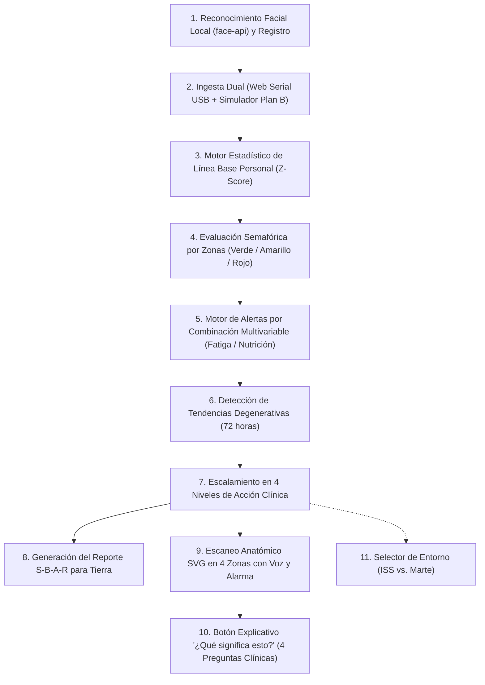

# 🚀 Synera — Galley Health Monitor
### *Autonomous Biomedical Copilot & Mission Health Intelligence*
**NASA Space Apps Challenge 2026**

Integrantes:
Fidel Willca
Ana Nuñez
Katherine Meneces
Luana Ojopi
Brenda Callzaya
Erick Flores

[](LICENSE)
[](#arquitectura-de-software-y-trade-offs)
[](#paradigma-local-first-y-tolerancia-a-desconexión)
[](#contexto-y-lecciones-de-misiones-reales)
[](#reporte-clínico-s-b-a-r-para-tierra)

---

## 📖 Tabla de Contenidos
1. [Visión y Concepto "Galley": El Chequeo que se Hace Solo](#visión-y-concepto-galley-el-chequeo-que-se-hace-solo)
2. [Contexto y Lecciones de Misiones Reales (Crew-11 y Artemis II)](#contexto-y-lecciones-de-misiones-reales)
3. [Diferenciador Clave: Detección Proactiva](#diferenciador-clave-detección-proactiva)
4. [Indicadores Clave, Nutrición y Sensores de Hardware](#indicadores-clave-nutrición-y-sensores-de-hardware)
5. [Mapeo de los 5 Riesgos del Vuelo Espacial (RIDGE)](#mapeo-de-los-5-riesgos-del-vuelo-espacial-ridge)
6. [Flujo de Funcionamiento en 11 Pasos](#flujo-de-funcionamiento-en-11-pasos)
7. [Escaneo Anatómico en 4 Zonas y Reconocimiento Facial Local](#escaneo-anatómico-en-4-zonas-y-reconocimiento-facial-local)
8. [Matriz de Escalamiento y Reporte S-B-A-R para Tierra](#matriz-de-escalamiento-y-reporte-s-b-a-r-para-tierra)
9. [Botón de Explicabilidad Médica: "¿Qué significa esto?"](#botón-de-explicabilidad-médica-qué-significa-esto)
10. [Arquitectura de Software y Hardware (Web Serial API)](#arquitectura-de-software-y-hardware-web-serial-api)
11. [Organización del Equipo y Flujo de Trabajo](#organización-del-equipo-y-flujo-de-trabajo)
12. [Guía de Inicio Rápido](#guía-de-inicio-rápido)

---

## 🌟 Visión y Concepto "Galley"

**Synera** (Equipo) presenta **Galley** (Prototipo), una plataforma biomédica autónoma diseñada para misiones de exploración espacial profunda (Luna / Artemis y Marte) donde el desfase de telecomunicaciones (hasta 44 minutos de retardo) o los apagones de enlace imposibilitan la asistencia médica interactiva en tiempo real desde la Tierra.

En estas misiones, los astronautas son los principales responsables de velar por su propia salud. Sin embargo, las herramientas tradicionales sobrecargan a la tripulación exigiendo registros manuales exhaustivos. **Galley** convierte el chequeo diario en una experiencia pasiva y sin esfuerzo:
* **Reconocimiento Facial Local:** El tripulante se acerca a la terminal de cabina; la cámara lo identifica localmente mediante `face-api` (TensorFlow.js en el navegador), carga su perfil, foto y línea base habitual, y **apaga la cámara de inmediato** para salvaguardar su privacidad.
* **Escaneo Anatómico en 4 Zonas:** Una línea interactiva desciende de arriba a abajo por una silueta humana (Cabeza, Pecho, Abdomen, Piernas), iluminando cada grupo anatómico en Verde, Amarillo o Rojo.
* **Voz y Sonido Guiado:** Síntesis de voz (Web Speech API) que narra los resultados de forma clara y alarma acústica (Web Audio API) ante irregularidades críticas.

---

## 🛰️ Contexto y Lecciones de Misiones Reales

Nuestra base científica se apoya en dos acontecimientos de la astronáutica contemporánea:
1. **Evacuación Médica de la ISS (Enero de 2026 — Tripulación Crew-11):**
   * Primera evacuación médica anticipada en los 25 años de servicio continuo de la Estación Espacial Internacional. Debido al cuadro clínico de un solo astronauta, los cuatro miembros debieron regresar a la Tierra un mes antes al compartir la misma cápsula de escape.
   * **Lección aprendida:** Diagnosticar objetivamente y a tiempo cuándo una alteración es crítica salva misiones de millones de dólares y preserva vidas humanas.
2. **Misión Artemis II (Retorno en Abril de 2026):**
   * Primera travesía tripulada más allá de la órbita baja terrestre en más de medio siglo. Instrumentó a los astronautas con biosensores portátiles para medir sueño, estrés, rendimiento cognitivo y dinámica de equipo.
   * **Lección aprendida:** El monitoreo continuo no invasivo y la correlación del estado cognitivo con los signos vitales son vitales en el espacio profundo.

---

## 🎯 Diferenciador Clave: Detección Proactiva

> **"No esperamos a que un indicador esté en rojo. Lo detectamos antes y decimos exactamente qué hacer."**

Galley va más allá de un semáforo pasivo tradicional:
1. **Línea Base Personal Individualizada:** Calcula la desviación estadística ($Z\text{-Score}$) de cada astronauta contra su propio "normal", evitando promedios poblacionales engañosos.
2. **Alertas Multivariables de Combinación:** Detecta cuadros complejos aunque cada signo por separado esté en rango amarillo (ej. pocas horas de sueño + taquicardia compensatoria + desánimo = fatiga operativa aguda).
3. **Análisis de Tendencias Degenerativas (72h):** Advierte si un indicador empeora de manera consecutiva antes de que el parámetro cruce la línea roja.
4. **Nutrición y Ejercicio como Contramedidas:** Evalúa el déficit de ingesta alimentaria (fatiga de menú, ESA 2017) y el cumplimiento de ejercicios de resistencia como factores críticos de salud.

---

## 🩺 Indicadores Clave, Nutrición y Sensores de Hardware

| Indicador | Sensor de Prototipo | Equivalente Comercial / Espacial | Interfaz | Variable Medida |
|---|---|---|---|---|
| **Frecuencia Cardíaca y SpO2** | Maxim MAX30102 / AD8232 | Polar H10 / Hexoskin | I2C / Web Serial | Pulso (BPM), SpO2 (%) y VFC (HRV) |
| **Temperatura Corporal** | Maxim MAX30205 (±0.1 °C) / MLX90614 | Core Temp Sensor | I2C | Temperatura cutánea de grado clínico |
| **Horas y Fases de Sueño** | Bosch BMI270 / MPU6050 | Oura Ring Gen 3 / Garmin | I2C / SPI | Actigrafía, vigilia y fases de sueño |
| **Estado de Ánimo** | Escala en pantalla táctil / Encoder | Tablet de cabina / Test PVT | GPIO / USB | Escala subjetiva (1-10) y tiempo de reacción |
| **Ingesta de Alimentos / Nutrición** | Registro de menú ISS FIT | EveryWear ESA Tracker | GUI / Manual | Porcentaje calórico de porciones y comidas |
| **Ejercicio Físico Diario** | Registro de contramedidas | Dispositivo ARED / Cicloergómetro | GUI / Sensor | Minutos e intensidad de ejercicio resistivo |
| **Radiación Espacial** | Fotodiodo PIN PocketGeiger | Dosímetro NASA RadPC | GPIO Interrupt | Tasa instantánea (µSv/h) y dosis acumulada (mSv) |

---

## 🌌 Mapeo de los 5 Riesgos del Vuelo Espacial (RIDGE)

La NASA clasifica las amenazas a la salud humana bajo el marco **RIDGE** (Human Research Program):

| Riesgo NASA (RIDGE) | Indicadores que lo reflejan en Synera | Justificación Fisiológica |
|---|---|---|
| **R — Space Radiation (Radiación Espacial)** | Dosímetro de radiación (tasa µSv/h y acumulado mSv) | Monitoreo continuo ante tormentas de partículas solares (SPE) y fondo cósmico galáctico. |
| **I — Isolation & Confinement (Aislamiento y Confinamiento)** | Estado de ánimo (1-10), horas y calidad de sueño | Detección precoz del desajuste circadiano, agotamiento psicosocial y falta de cohesión. |
| **D — Distance from Earth (Distancia de la Tierra)** | Arquitectura Local-First y reporte S-B-A-R en cola | Imposibilidad de evacuación inmediata; autonomía médica total ante retrasos de hasta 44 min. |
| **G — Gravity Fields (Microgravedad / Campos Gravitatorios)** | Presión arterial, frecuencia cardíaca y ejercicio | Redistribución cefálica de fluidos (síndrome neuro-ocular SANS), atrofia muscular y pérdida ósea. |
| **E — Hostile / Closed Environments (Entornos Hostiles y Cerrados)** | Temperatura corporal, sueño y nutrición | Regulación térmica bajo ventilación forzada en trajes/módulos y fatiga de menú. |

---

## 🔄 Flujo de Funcionamiento en 11 Pasos



---

## 🧍 Escaneo Anatómico en 4 Zonas y Reconocimiento Facial Local

1. **Cabeza:** Estado de ánimo, fatiga neurocognitiva, temperatura cutánea cefálica y calidad del sueño.
2. **Pecho:** Frecuencia cardíaca (BPM), variabilidad (HRV) y oxigenación sanguínea (SpO2).
3. **Abdomen:** Ingesta de alimentos/calorías, confort gastrointestinal y metabolismo.
4. **Piernas / Musculoesquelético:** Cumplimiento de contramedidas de ejercicio físico y prevención de atrofia.

---

## 🚨 Matriz de Escalamiento y Reporte S-B-A-R para Tierra

### Niveles de Escalamiento
* **Nivel 1 — Autocuidado:** Indicadores nominales. Descanso programado, hidratación y chequeo rutinario en 24h.
* **Nivel 2 — Avisar a la Tripulación:** Múltiples alertas moderadas o tendencia negativa. Informar a un compañero para supervisión cruzada; revisar botiquín a bordo.
* **Nivel 3 — Consultar a Médicos de Vuelo:** Indicador en ROJO o alerta de fatiga severa. Suspender actividades extravehiculares (EVA) y encolar el reporte **S-B-A-R** para transmisión.
* **Nivel 4 — Consulta Urgente:** Emergencia refractaria. Notificar de inmediato al Comandante y enlazar prioritariamente con el Cirujano de Vuelo.

### Estructura S-B-A-R
* **Situation (Situación):** Qué síntoma agudo o desviación se está manifestando.
* **Background (Antecedentes):** Línea base personal habitual del astronauta y evolución en los últimos días.
* **Assessment (Evaluación):** Estado de los semáforos, alertas activas e inferencia clínica determinista.
* **Recommendation (Recomendación):** Medidas inmediatas de abordo y solicitud concreta al Cirujano de Vuelo.

---

## ❓ Botón de Explicabilidad Médica: "¿Qué significa esto?"

Para garantizar que cualquier tripulante comprenda su estado sin ser médico, cada indicador responde a cuatro preguntas fundamentales:
1. **¿Qué mide y por qué se mide en el espacio?**
2. **¿Qué riesgo del vuelo espacial (RIDGE) lo está afectando?**
3. **¿Qué es normal para mí y por qué cambió de color?**
4. **¿Qué debo hacer ahora mismo y cuándo debo escalar la situación?**

---

## 🏗️ Arquitectura de Software y Hardware (Web Serial API)

El sistema emplea **Arquitectura Hexagonal (Puertos y Adaptadores)** con conexión directa por cable USB vía **Web Serial API** (115200 baudios):

```text
+------------------------+          USB Serial (115200)          +------------------------+
|   ESP32 + MAX30102     | ------------------------------------> |   Aplicación Web       |
|   (Nodo de Hardware)   |  Payload JSON a 1 Hz                  |   (Chrome / Edge)      |
+------------------------+                                       +-----------+------------+
            ^                                                                |
            |                                                                v
+-----------+------------+                                       +-----------+------------+
|  Plan B: Simulador     |                                       |   Núcleo Clínico       |
|  Python (Mock Sensor)  |                                       |   Hexagonal Local      |
+------------------------+                                       +------------------------+
```

---

## 👥 Organización del Equipo y Flujo de Trabajo

* **Hardware & Firmware:** **Erick** & **Luana** (ESP32, MAX30102, Wokwi, firmware C++, Web Serial).
* **Software & UI/UX:** **Katherine** & **Brenda** (Escaneo SVG, `face-api`, Web Speech/Audio, Web Serial API, S-B-A-R).
* **Biotecnología & Datos:** **Johan** & **Fidel** (Estándares NASA-STD-3001, datasets 14 días, reglas de fatiga/nutrición).

Para conocer el protocolo detallado, checkpoints horarios y criterios de aceptación, consulta el documento [WORKFLOW.md](file:///home/university/Documents/Personal/Progamming/UniversalSpaceApps/WORKFLOW.md).

---

## ⚡ Guía de Inicio Rápido

### 1. Clonar el Repositorio
```bash
git clone git@github.com:ErickFP7314/synera-spaceapps.git
cd synera-spaceapps
```

### 2. Ejecutar el Simulador de Hardware (Plan B)
```bash
# Modo normal:
python3 hardware/hardware-simulator/simulator.py --scenario normal

# Modo fatiga operacional (Paso 4):
python3 hardware/hardware-simulator/simulator.py --scenario fatigue_combination --count 3
```

### 3. Ejecutar Pruebas Unitarias de Reglas Clínicas
```bash
cd software
npm test
```

---

<p align="center">
  <b>Synera — Galley Health Monitor | NASA Space Apps Challenge 2026</b><br>
  <i>Cuidando la salud de quienes exploran las fronteras de la humanidad.</i>
</p>
