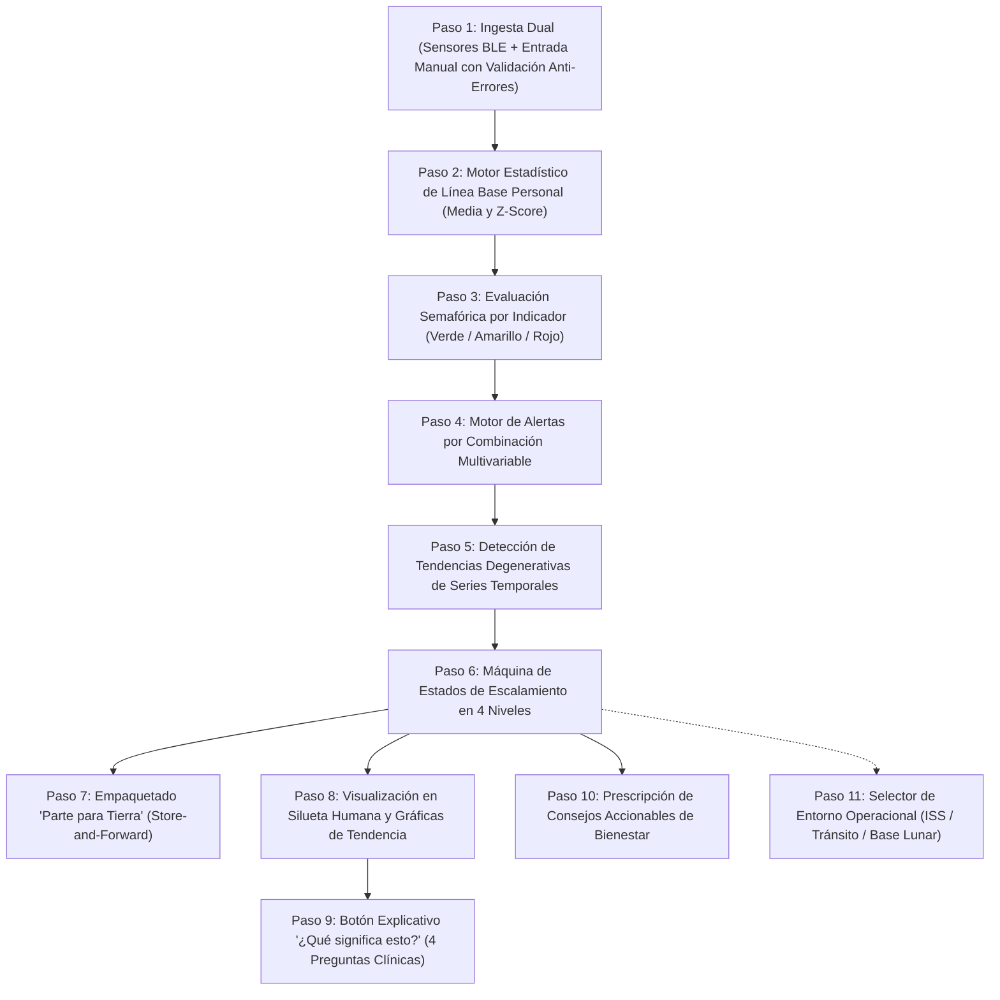

# 🚀 Synera — Copiloto de Salud para Astronautas
### *Autonomous Biomedical Copilot & Mission Health Intelligence*
**NASA Space Apps Challenge**

[](LICENSE)
[](#arquitectura-de-software-y-trade-offs)
[](#paradigma-local-first-y-tolerancia-a-desconexión)
[](#contexto-y-lecciones-de-misiones-reales)

---

## 📖 Tabla de Contenidos
1. [Visión y Propósito del Proyecto](#visión-y-propósito-del-proyecto)
2. [Contexto y Lecciones de Misiones Reales](#contexto-y-lecciones-de-misiones-reales)
3. [Diferenciador Clave: Detección Proactiva](#diferenciador-clave-detección-proactiva)
4. [Los 6 Indicadores Clave y Sensores de Hardware](#los-6-indicadores-clave-y-sensores-de-hardware)
5. [Mapeo de los 5 Riesgos del Vuelo Espacial (RIDGE)](#mapeo-de-los-5-riesgos-del-vuelo-espacial-ridge)
6. [Flujo de Funcionamiento en 11 Pasos](#flujo-de-funcionamiento-en-11-pasos)
7. [Matriz de Escalamiento en 4 Niveles](#matriz-de-escalamiento-en-4-niveles)
8. [Botón de Explicabilidad Médica: "¿Qué significa esto?"](#botón-de-explicabilidad-médica-qué-significa-esto)
9. [Arquitectura de Software y Trade-offs](#arquitectura-de-software-y-trade-offs)
10. [Estructura del Monorepo](#estructura-del-monorepo)
11. [Flujo de Trabajo entre Equipos (Hardware vs. Software)](#flujo-de-trabajo-entre-equipos-hardware-vs-software)
12. [Guía de Inicio Rápido](#guía-de-inicio-rápido)

---

## 🌟 Visión y Propósito del Proyecto

**Synera** es una plataforma integral de monitoreo biomédico y soporte de decisiones clínicas autónomas para astronautas en misiones espaciales de larga duración (Estación Espacial Internacional, órbita cislunar Artemis y futuras misiones a Marte).

El sistema sigue la salud del astronauta comparándolo con su **propio "normal" (línea base personal individualizada)**, detecta señales tempranas de deterioro antes de que los indicadores lleguen a niveles críticos y orienta a la tripulación sobre **qué acciones tomar y cuándo consultar o solicitar auxilio a la Tierra**, operando de forma 100% autónoma incluso ante caídas prolongadas de comunicaciones.

---

## 🛰️ Contexto y Lecciones de Misiones Reales

Nuestra investigación y diseño técnico se fundamentan en dos hitos astronáuticos recientes:

1. **Evacuación Médica de la ISS (Enero de 2026 — Crew-11):**
   * Por primera vez en 25 años de ocupación continua de la Estación Espacial Internacional, se ejecutó una evacuación médica anticipada. Debido al cuadro agudo de un único tripulante y dado que la cápsula espacial es el único vehículo de escape compartido, los cuatro integrantes debieron abortar la misión un mes antes.
   * **Lección aprendida:** Diagnosticar objetivamente y a tiempo cuándo una alteración es crítica salva misiones y vidas, evitando evacuaciones precipitadas o intervenciones tardías.
2. **Misión Artemis II (Retorno en Abril de 2026):**
   * Primera expedición con tripulación humana más allá de la órbita baja terrestre en más de 50 años. Desplegó instrumentación vestible para monitorizar sueño, estrés psicofisiológico, rendimiento cognitivo y cohesión de equipo en espacio profundo.
   * **Lección aprendida:** El monitoreo continuo mediante biosensores no invasivos y la correlación del estado neurocognitivo con los signos vitales son indispensables en misiones de exploración.

---

## 🎯 Diferenciador Clave: Detección Proactiva

> **"No esperamos a que un indicador esté en rojo. Lo detectamos antes y decimos exactamente qué hacer."**

La mayoría de las herramientas médicas tradicionales operan de forma reactiva con umbrales fijos poblacionales. Synera introduce tres niveles de análisis preventivo:
1. **Línea Base Personalizada:** Un pulso en reposo de 55 bpm puede ser normal para un atleta y bradicardia para otro; el sistema calcula la desviación estadística individual ($Z\text{-Score}$).
2. **Alertas Multivariables de Combinación:** Detecta cuadros complejos aunque cada signo por separado esté en rango amarillo (ej. privación de sueño + taquicardia compensatoria + desánimo = fatiga operativa severa).
3. **Análisis de Tendencias Degenerativas:** Alerta si una variable se degrada día tras día, anticipando el problema antes de que el tanque quede vacío.

---

## 🩺 Los 6 Indicadores Clave y Sensores de Hardware

Para garantizar viabilidad entre el desarrollo de prototipos y la tecnología de grado espacial, definimos componentes electrónicos para placas personalizadas junto a sus equivalentes comerciales:

| Indicador | Sensor de Prototipo | Equivalente Comercial / Espacial | Interfaz | Variable Medida |
|---|---|---|---|---|
| **1. Frecuencia Cardíaca** | Maxim MAX30102 / AD8232 | Polar H10 / Hexoskin | I2C / Analógico | Pulso (BPM), SpO2 (%) y VFC (HRV) |
| **2. Presión Arterial** | Módulo NIBP OEM / Omron D6F | Omron Evolv / ConTEC08A | UART / BLE | Sistólica y Diastólica (mmHg) |
| **3. Temperatura Corporal** | Maxim MAX30205 (±0.1 °C) / MLX90614 | Core Temp Sensor | I2C | Temperatura cutánea de grado clínico |
| **4. Glucosa** | Lector NFC PN532 / Simulador | FreeStyle Libre 3 / Dexcom G7 | SPI / BLE | Glucosa intersticial continua |
| **5. Horas de Sueño** | Bosch BMI270 / MPU6050 | Oura Ring Gen 3 / Garmin | I2C / SPI | Actigrafía, vigilia y fases de sueño |
| **6. Estado de Ánimo** | Pantalla táctil / Encoder rotativo | Tablet de cabina / Test PVT | GPIO / USB | Escala subjetiva (1-10) y tiempo de reacción |
| **Extra: Radiación Espacial** | Fotodiodo PIN PocketGeiger | Dosímetro NASA RadPC | GPIO Interrupt | Tasa en µSv/h y dosis acumulada en mSv |

### Arquitectura de Nodos de Hardware
* **Nodo Wearable (Adquisición):** Microcontrolador **ESP32-S3** o **Nordic nRF52840** con Bluetooth Low Energy (BLE 5.0), procesando el filtrado de ruido de movimiento in situ.
* **Nodo Central de Cabina (Edge Gateway):** **Raspberry Pi 5** con pantalla táctil interactiva de 7 pulgadas que ejecuta el almacenamiento Local-First, la interfaz de silueta humana y la ingesta manual de respaldo.

---

## 🌌 Mapeo de los 5 Riesgos del Vuelo Espacial (RIDGE)

La NASA clasifica las amenazas a la salud humana bajo el marco **RIDGE**. Synera correlaciona directamente cada riesgo con telemetría objetiva:

| Riesgo NASA | Indicadores que lo reflejan en Synera | Justificación Fisiológica |
|---|---|---|
| **R — Space Radiation (Radiación Espacial)** | Dosímetro de radiación (tasa µSv/h y acumulado mSv) | Monitoreo ante eventos de partículas solares (SPE) y fondo cósmico galáctico. |
| **I — Isolation & Confinement (Aislamiento y Confinamiento)** | Estado de ánimo (1-10), horas y calidad de sueño | Detección precoz del deterioro circadiano, síndrome de burnout y estrés psicosocial. |
| **D — Distance from Earth (Distancia de la Tierra)** | Arquitectura Local-First y "Parte para Tierra" | Imposibilidad de evacuación inmediata; necesidad de operar sin conectividad. |
| **G — Gravity Fields (Microgravedad / Campos Gravitatorios)** | Presión arterial y frecuencia cardíaca | Redistribución cefálica de fluidos (síndrome neuro-ocular SANS) y desacondicionamiento miocárdico. |
| **E — Hostile / Closed Environments (Entornos Hostiles y Cerrados)** | Temperatura corporal, sueño y glucosa | Regulación térmica bajo ventilación forzada en trajes/módulos y metabolismo energético. |

---

## 🔄 Flujo de Funcionamiento en 11 Pasos



1. **Paso 1: Registro Diario e Ingesta Híbrida:** Recepción vía BLE de biosensores o formulario manual con validación de rangos biológicamente admisibles (rechaza incongruencias como 360 °C o presión diastólica mayor a la sistólica).
2. **Paso 2: Línea Base Personal:** Cálculo dinámico de la media móvil y desviación estándar para cada astronauta tras los primeros días de adaptación.
3. **Paso 3: Semáforo por Indicador:** Calificación visual en Verde (nominal), Amarillo (atención) o Rojo (crítico) combinando desvíos $Z\text{-Score}$ y límites fisiológicos de referencia.
4. **Paso 4: Alerta por Combinación Multivariable:** Inferencia cruzada determinista (ej. fiebre incipiente = hipertermia + taquicardia sinusal).
5. **Paso 5: Alerta de Tendencia:** Detección de pendientes negativas consecutivas en 72 horas para prevenir fallos antes de alcanzar el rango crítico.
6. **Paso 6: Escalamiento en 4 Niveles:** Traducción del estado global a una acción clara e inequívoca.
7. **Paso 7: Parte para Tierra:** Resumen clínico conciso de 1 página optimizado para transmisión asíncrona de bajo ancho de banda.
8. **Paso 8: Gráficas y Visualización:** Dashboard interactivo con figura humana segmentada y mapeo cromático anatómico.
9. **Paso 9: Botón Explicativo "¿Qué significa esto?":** Explicación clínica accesible sin jerga médica compleja.
10. **Paso 10: Consejos de Bienestar:** Pautas inmediatas de descanso, ergonomía, hidratación o reajuste de tareas.
11. **Paso 11: Selector de Entorno:** Adaptación automática de parámetros según la gravedad y radiación de la estación (ISS), nave en tránsito o campamento base lunar.

---

## 🚨 Matriz de Escalamiento en 4 Niveles

| Nivel | Condición Clínica | Acción Recomendada por Synera | Protocolo de Comunicación |
|:---:|---|---|---|
| **1. Autocuidado** | Indicadores nominales o fluctuaciones leves aisladas. | Hidratación guiada, descanso en ciclo circadiano, repetir chequeo en 24h. | Registro local rutinario en cabina. |
| **2. Avisar a la Tripulación** | Múltiples indicadores en amarillo o tendencia degenerativa sostenida. | Notificar a un compañero de módulo para supervisión cruzada; revisar botiquín a bordo. | Notificación interna en el nodo de cabina. |
| **3. Consultar a Médicos de Vuelo** | Un indicador en ROJO o activación de alerta por combinación. | Suspender actividades extravehiculares (EVA); aplicar contramedidas preventivas. | Transmitir "Parte para Tierra" en la próxima ventana de enlace. |
| **4. Consulta Urgente** | Múltiples rojos o parámetro crítico refractario que no mejora. | Iniciar protocolo médico de emergencia; relevar al astronauta de tareas operativas críticas. | Contacto prioritario de emergencia inmediato con el Cirujano de Vuelo (Flight Surgeon). |

---

## ❓ Botón de Explicabilidad Médica: "¿Qué significa esto?"

Para garantizar que cualquier tripulante (independientemente de si es especialista de misión, piloto o geólogo) entienda su condición, cada métrica incluye un botón modal que responde de forma determinista y sin ambigüedades a cuatro preguntas obligatorias:

1. **¿Qué mide y por qué se mide en el espacio?**
2. **¿Qué riesgo del vuelo espacial (RIDGE) lo está afectando?**
3. **¿Qué es normal para mí y por qué cambió de color?**
4. **¿Qué debo hacer ahora mismo y cuándo debo escalar la situación?**

---

## 🏗️ Arquitectura de Software y Trade-offs

Implementamos una **Arquitectura Hexagonal (Puertos y Adaptadores)** con diseño **Local-First**, permitiendo desacoplar completamente la lógica clínica de la infraestructura externa:

```text
               +-------------------------------------------------------+
               |                       UI LAYER                        |
               |   [HumanFigure]  [ExplainButton]  [EscalationDash]   |
               +---------------------------+---------------------------+
                                           |
                                           v
+-------------------------------------------------------------------------------------+
|                                  APPLICATION LAYER                                  |
|         [RecordDailyHealth UseCase]           [GenerateEarthReport UseCase]         |
|                                           |                                         |
|                   +-----------------------+-----------------------+                 |
|                   |                       |                       |                 |
|                   v                       v                       v                 |
|          [SensorInputPort]       [Domain Logic Bus]       [EarthSyncPort]           |
+-------------------+-----------------------+-----------------------+-----------------+
                    ^                       |                       |
                    |                       v                       |
+-------------------+---------+  +----------+----------+  +---------+-----------------+
|   INFRASTRUCTURE ADAPTERS   |  |     DOMAIN CORE     |  |   PERSISTENCE & SYNC      |
|  - Web Bluetooth (BLE)      |  |  - Baseline Engine  |  |  - SQLite (WAL Mode)      |
|  - Hardware UART Serial     |  |  - Rules Engine     |  |  - Store-and-Forward      |
|  - Manual Input Form        |  |  - Escalation State |  |  - Ground Sync Queue      |
|  - Mock HW Simulator        |  |  - Medical Ranges   |  |                           |
+-----------------------------+  +---------------------+  +---------------------------+
```

### Matriz de Trade-offs Arquitectónicos
* **Disponibilidad Local-First vs. Consistencia en la Nube:** Debido a la latencia espacial y los cortes de enlace, sacrificamos sincronización instantánea con servidores en Tierra en favor de **autonomía médica total al borde** (teorema CAP volcado a AP: Alta Disponibilidad y Tolerancia a Particiones).
* **Motor Determinista vs. Modelos Black-Box de Deep Learning:** La seguridad del paciente prohíbe algoritmos opacos que puedan sufrir alucinaciones en emergencias. Utilizamos $Z\text{-Score}$ y árboles de decisión verificables.
* **Arquitectura Hexagonal vs. Monolito Rápido:** Invertir en puertos e interfaces desacopla el trabajo de hardware y software desde el primer día.

---

## 📂 Estructura del Monorepo

```text
synera-spaceapps/
├── README.md                           # Documentación técnica integral
├── contracts/                          # FUENTE ÚNICA DE LA VERDAD (Compartido HW y SW)
│   ├── telemetry-payload.schema.json   # Esquema JSON de tramas biomédicas (BLE/Serial)
│   ├── earth-report.schema.json        # Esquema del "Parte para Tierra" (Paso 7)
│   ├── ble-gatt-profile.yaml           # Servicios y características Bluetooth GATT
│   └── medical-ranges-config.json      # Rangos de referencia por entorno (ISS, Nave, Luna)
│
├── hardware/                           # ÁREA DE ELECTRÓNICA Y SENSORES
│   ├── firmware/
│   │   ├── wearable-node/              # Firmware C++ (PlatformIO) para ESP32-S3 / nRF52
│   │   │   ├── platformio.ini          # Configuración de compilador y librerías
│   │   │   └── src/
│   │   │       ├── main.cpp            # Entrada y bucle de telemetría
│   │   │       ├── sensors/            # Drivers: MAX30102, MAX30205, BMI270, Dosímetro
│   │   │       ├── filters/            # Filtros de movimiento y validación física
│   │   │       └── comms/              # Transmisión BLE GATT / Serial según contratos
│   │   └── calibration-tools/          # Rutinas de calibración de sensores
│   ├── pcb-schematics/                 # Esquemáticos y diseño de PCB en KiCad
│   ├── enclosure-cad/                  # Modelos 3D (.STL / .STEP) de la carcasa del dispositivo
│   └── hardware-simulator/             # Simulador en Python de tramas para pruebas de software
│       ├── simulator.py                # Inyector de escenarios (normal, fatiga, fiebre, etc.)
│       └── requirements.txt
│
├── software/                           # ÁREA DE DESARROLLO DE SOFTWARE
│   ├── package.json
│   ├── tsconfig.json
│   ├── src/
│   │   ├── domain/                     # Núcleo puro (independiente de UI y BD)
│   │   │   ├── models/types.ts         # Entidades de dominio y tipos clínicos
│   │   │   ├── baseline-engine/        # Paso 2: Cálculo estadístico de línea base individual
│   │   │   ├── traffic-light/          # Paso 3: Clasificador semafórico
│   │   │   ├── anomaly-rules/          # Pasos 4 y 5: Reglas multivariables y tendencias
│   │   │   ├── escalation-matrix/      # Paso 6: Máquina de estados de los 4 niveles
│   │   │   └── environment-profiles/   # Paso 11: Perfiles ISS, Nave y Base Lunar
│   │   ├── application/                # Casos de uso y puertos
│   │   │   ├── ports/
│   │   │   │   ├── SensorInputPort.ts  # Puerto de entrada de telemetría
│   │   │   │   └── EarthSyncPort.ts    # Puerto de sincronización asíncrona
│   │   │   └── use-cases/
│   │   │       ├── RecordDailyHealth.ts
│   │   │       └── GenerateEarthReport.ts
│   │   ├── infrastructure/             # Adaptadores externos
│   │   │   ├── hardware-adapters/      # Receptor BLE / Serial / WebSockets
│   │   │   ├── persistence/            # SQLite Local-First con modo WAL
│   │   │   └── validators/             # Paso 1: Validador de rangos absurdos
│   │   └── ui/                         # Interfaz gráfica de usuario
│   │       ├── components/
│   │       │   ├── HumanFigure2D3D/    # Silueta anatómica codificada por colores
│   │       │   ├── ExplainButton/      # Modal "¿Qué significa esto?"
│   │       │   ├── TrendCharts/        # Gráficas de tendencias temporales
│   │       │   └── WellnessTips/       # Guías accionables de bienestar
│   │       └── pages/
│   │           ├── DailyCheckIn/       # Formulario manual + recepción de sensores
│   │           ├── EscalationDashboard/# Tablero central de escalamiento clínico
│   │           └── EarthReportView/    # Vista previa del "Parte para Tierra"
│   └── tests/
│       └── rules.test.ts               # Batería de pruebas unitarias de reglas médicas
│
└── docs/                               # DOCUMENTACIÓN Y AUDITORÍA
    ├── architecture-decisions/         # Registros de Decisiones de Arquitectura (ADR)
    └── medical-resources/              # Directrices clínicas y fuentes oficiales NASA
```

---

## 🤝 Flujo de Trabajo entre Equipos (Hardware vs. Software)

1. **El Contrato es Sagrado (`/contracts`):** Ningún equipo modifica archivos en `contracts/` sin consenso previo. Es el punto de enlace que define la estructura JSON, los rangos médicos y los UUIDs de Bluetooth.
2. **Desarrollo Paralelo sin Bloqueos:**
   * El **Equipo de Hardware** trabaja en `hardware/`, programando microcontroladores, calibrando sensores y verificando la PCB sin requerir que la interfaz visual esté terminada.
   * El **Equipo de Software** trabaja en `software/`. Para validar pantallas, cálculos de línea base y alertas multivariables sin depender de la placa física, ejecuta el **Simulador de Hardware** (`hardware/hardware-simulator/simulator.py`).
3. **Reglas de Git:** El directorio `contracts/` actúa como punto de sincronización de pull requests.

---

## ⚡ Guía de Inicio Rápido

### 1. Clonar el Repositorio
```bash
git clone git@github.com:ErickFP7314/synera-spaceapps.git
cd synera-spaceapps
```

### 2. Probar el Simulador de Hardware (Python)
Simula la emisión de paquetes biomédicos idénticos a los del wearable físico:
```bash
# Modo normal:
python3 hardware/hardware-simulator/simulator.py --scenario normal

# Modo simulación de fatiga operativa (Paso 4):
python3 hardware/hardware-simulator/simulator.py --scenario fatigue_combination --count 3

# Simulación de infección / fiebre en microgravedad:
python3 hardware/hardware-simulator/simulator.py --scenario fever_infection
```

### 3. Ejecutar el Núcleo de Software y Pruebas Unitarias (Node/TypeScript)
```bash
cd software
npm test
```

### 4. Compilar Firmware del Wearable (PlatformIO)
```bash
cd hardware/firmware/wearable-node
pio run -e esp32s3_node
```

---

<p align="center">
  <b>Synera — NASA Space Apps Challenge</b><br>
  <i>Cuidando la salud de quienes exploran las fronteras de la humanidad.</i>
</p>
