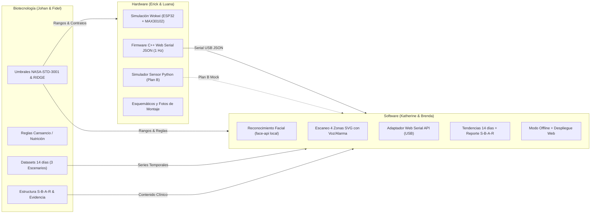

# 🛰️ Protocolo y Flujo de Trabajo del Equipo: SYNERA
### **NASA Space Apps Challenge 2026 | Proyecto Galley Health Monitor**

---

## 👥 1. Organización del Equipo y Células de Trabajo

| Célula | Integrantes | Especialidad y Dominio Principal |
|---|---|---|
| **Hardware & Firmware** | **Erick** & **Luana** | Microcontroladores (ESP32), sensores (MAX30102, temperatura), simulación en Wokwi, firmware C++ y transmisión Web Serial USB. |
| **Software & UI/UX** | **Katherine** & **Brenda** | Arquitectura Web, reconocimiento facial local (`face-api`), visualización anatómica 4 zonas (SVG), Web Speech/Audio y Web Serial API. |
| **Biotecnología & Datos** | **Johan** & **Fidel** | Validación científica NASA (NASA-STD-3001, HRP, ESA), modelado de reglas de cansancio/nutrición, datasets de 14 días y reporte S-B-A-R. |

---

## 📜 2. Regla de Oro: Enfoque "Contracts-First"

El directorio [`contracts/`](./contracts) es la **fuente única de la verdad** técnica y clínica del proyecto:
1. **Nadie modifica `contracts/` de forma unilateral:** Cualquier cambio a los esquemas JSON (`telemetry-payload.schema.json`, `earth-report.schema.json`), perfiles BLE o rangos médicos debe acordarse previamente entre las tres células.
2. **Desarrollo Desacoplado sin Bloqueos:**
   - **Hardware** compila y valida que sus tramas seriales cumplan con el esquema JSON.
   - **Software** utiliza el simulador sintético (`hardware/hardware-simulator/simulator.py`) para programar y renderizar la interfaz sin necesidad de esperar a que el circuito esté soldado.
   - **Biotecnología** alimenta los umbrales clínicos y genera los datasets de 14 días en base al contrato acordado.

---

## 🔄 3. Matriz de Entregables e Interacción entre Células



---

## 📋 4. Asignación Detallada de Tareas por Integrante

### 🛠️ Célula Hardware: Erick & Luana
* **Tarea H1 — Definición de BOM y Simulación Wokwi:**
  - Configurar en Wokwi el proyecto con ESP32 DevKit y sensor I2C MAX30102.
  - Verificar librerías compatibles de sensor óptico y asignación de pines (SDA: GPIO21, SCL: GPIO22).
  - *DoD (Criterio de Aceptación):* Enlace a proyecto Wokwi ejecutable y público documentado en `hardware/simulation-wokwi/README.md`.
* **Tarea H2 — Firmware C++ para Web Serial (115200 baudios):**
  - Desarrollar firmware en PlatformIO/Arduino que adquiera pulso/SpO2 y emita por puerto serie cada 1 segundo un payload JSON válido: `{"t": 1731600000, "hr": 65, "spo2": 98, "temp": 36.6}`.
  - *DoD:* El monitor serie a 115200 baudios imprime tramas JSON válidas sin caracteres corruptos ni pausas erráticas.
* **Tarea H3 — Script Simulador de Sensor Físico (Plan B):**
  - Implementar script local en Python (`hardware/hardware-simulator/simulator.py`) que replique la emisión de tramas seriales o simulación directa en navegador ante fallos del hardware.
  - *DoD:* El simulador corre localmente y permite elegir escenarios (`normal`, `fatigue_combination`, `fever_infection`).
* **Tarea H4 — Documentación Esquemática y Evidencias de Montaje:**
  - Diseñar diagrama de conexiones claras y capturar fotografías/videos del prototipo físico para la entrega a los jueces.
  - *DoD:* Archivos esquemáticos guardados en `hardware/pcb-schematics/` y descripción en `README.md`.

---

### 💻 Célula Software: Katherine & Brenda
* **Tarea S1 — Reconocimiento Facial Local (`face-api`) y Gestión de Perfiles:**
  - Cargar biblioteca `@vladmandic/face-api` de forma local (sin depender de internet durante el demo).
  - Reconocer al astronauta, cargar su foto y línea base en `localStorage`, y apagar la cámara de inmediato para salvaguardar su privacidad.
  - *DoD:* Reconoce al menos a 2 integrantes del equipo registrados sin confundirlos; apaga la cámara tras el match.
* **Tarea S2 — Animación de Escaneo Anatómico en 4 Zonas (SVG) con Voz y Alarma:**
  - Implementar la silueta anatómica interactiva dividida en: Cabeza, Pecho, Abdomen y Piernas.
  - Integrar Web Speech API para narrar los resultados en inglés/español y Web Audio API para alarma sonora si hay zonas rojas.
  - *DoD:* La animación de barrido corre suavemente y cambia el color de las zonas según los datos; la síntesis de voz se activa de forma fluida.
* **Tarea S3 — Conector Web Serial API (Lectura USB directa):**
  - Implementar en JavaScript el botón de conexión "Conectar Sensor USB" usando la Web Serial API nativa de Chrome/Edge.
  - Parsear el flujo de texto a 115200 baudios y actualizar el estado global de la app.
  - *DoD:* Al pulsar el botón y seleccionar el puerto COM/USB, los valores del ESP32 se reflejan instantáneamente en pantalla.
* **Tarea S4 — Pantalla de Tendencias de 14 Días y Reporte S-B-A-R:**
  - Renderizar gráficas históricas de 14 días para los 6 indicadores comparados con la línea base personal.
  - Integrar el modal y vista del reporte médico S-B-A-R listo para transmisión a Tierra con selector de entorno (ISS / Marte).
  - *DoD:* Gráficas dinámicas interactivas y reporte S-B-A-R exportable o visualizable en 1 página.
* **Tarea S5 — Modo Offline y Despliegue en GitHub Pages:**
  - Garantizar que todos los assets (librerías JS, modelos neuronales de caras, fuentes e iconos) funcionen sin conexión a internet.
  - Desplegar la demo en vivo a GitHub Pages para acceso directo de los evaluadores.
  - *DoD:* La app abre y funciona 100% en modo incógnito sin conexión a internet; enlace público disponible.

---

### 🧬 Célula Biotecnología & Datos: Johan & Fidel
* **Tarea B1 — Validación de Umbrales Clínicos NASA-STD-3001 y Peligros RIDGE:**
  - Investigar y compilar los estándares de salud de la NASA (**NASA-STD-3001 Vol. 1**, Human Research Roadmap).
  - Mapear cada uno de los 6 indicadores + radiación con los 5 peligros espaciales (Radiación, Aislamiento, Distancia, Gravedad y Entorno Hostil).
  - *DoD:* Tabla completa de umbrales nominales, preventivos y críticos citando fuentes oficiales en `docs/medical-resources/`.
* **Tarea B2 — Generación del Dataset Sintético de 14 Días (3 Escenarios):**
  - Generar el archivo JSON/CSV con series temporales para 14 días reflejando 3 condiciones:
    1. Adaptación nominal en microgravedad.
    2. Deterioro progresivo por fatiga, desvelo y déficit nutricional.
    3. Cuadro agudo de estrés cardiovascular o febril.
  - *DoD:* Archivo validado en `docs/synthetic-datasets/dataset-14days-scenarios.json`.
* **Tarea B3 — Modelado de Reglas de Cansancio y Nutrición:**
  - Formular la lógica determinista para alertas de combinación (sueño bajo + pulso alto + ánimo bajo) y alertas por déficit nutricional (fatiga de menú, ESA EveryWear).
  - *DoD:* Algoritmos documentados con justificación biológica libre de cajas negras en `docs/scientific-evidence/`.
* **Tarea B4 — Redacción del Reporte S-B-A-R y las 4 Preguntas de Explicabilidad:**
  - Redactar los textos clínicos en lenguaje claro para las 4 preguntas del botón "¿Qué significa esto?".
  - Estructurar el formato S-B-A-R para la entrega del reporte al Cirujano de Vuelo.
  - *DoD:* Textos revisados en español e inglés listos para ser incorporados al frontend en `software/src/`.
* **Tarea B5 — Declaración de Uso Ético de IA y Bibliografía Oficial:**
  - Redactar la declaración transparente del uso de herramientas de IA según las directrices de la NASA Space Apps Challenge y compilar las referencias bibliográficas.
  - *DoD:* Sección de IA y lista de referencias con enlaces verificados incluida en la entrega final.

---

## ⏱️ 5. Cronograma y Checkpoints del Hackatón (39 Horas)

```text
[Viernes Noche / Sábado 09:00] -- Checkpoint 1: Congelamiento de Contratos y Plan B
  * Reunión de alineación: validación de contratos en /contracts.
  * Hardware inicia Wokwi; Software monta la estructura web; Biotecnología inicia búsqueda de umbrales.

[Sábado 14:00] ---------------- Checkpoint 2: Prototipos Aislados y Dataset
  * Biotecnología entrega dataset de 14 días y reglas de fatiga.
  * Software integra el escaneo SVG y reconocimiento facial con datos sintéticos.
  * Hardware logra emisión JSON en Wokwi / ESP32.

[Sábado 20:00] ---------------- Checkpoint 3: Primera Integración Web Serial
  * Conexión exitosa entre Web Serial API del navegador y el ESP32 (o simulador de respaldo).
  * Reporte S-B-A-R y visualización de 14 días funcionando en frontend.

[Domingo 12:00] --------------- Checkpoint 4: Congelamiento de Código (Code Freeze)
  * Pruebas en modo offline (sin internet) y verificación bilingüe (EN/ES).
  * Pruebas de compatibilidad en Chrome y Edge.

[Domingo 16:00 - 20:00] ------- Checkpoint 5: Grabación de Demo y Entrega Oficial
  * Grabación del video de 30 segundos (o 7 diapositivas) en inglés sin datos sensibles.
  * Revisión de enlaces en ventana privada y envío del formulario antes de las 20:00 (límite 23:59).
```

---

## 🛡️ 6. Criterios de Aceptación Globales (Definition of Done - DoD del Proyecto)

1. **Autonomía Total (Local-First):** La aplicación corre en el navegador sin depender de servidores backend externos ni conectividad a internet.
2. **Explicabilidad Médica Trazable:** Ninguna recomendación médica proviene de modelos generativos de caja negra; el 100% de las alertas se justifican mediante el botón "¿Qué significa esto?" y referencias de la NASA.
3. **Resiliencia Demostrable (Plan B):** Si el hardware físico no está presente o se desconecta, el simulador de respaldo permite mostrar la experiencia completa sin alterar el código de la app.
4. **Entrega Oficial Impecable:** Repositorio público limpio, video demo de 30s en inglés, declaración de IA completada y referencias oficiales comprobadas.
