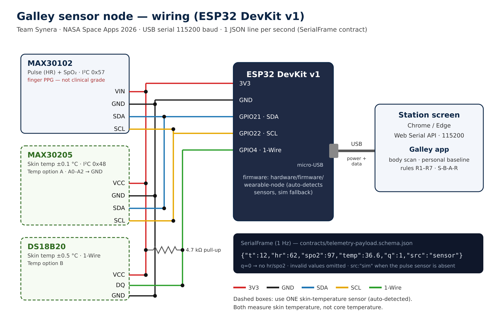

# Simulación en Wokwi — nodo sensor Galley (ESP32 DevKit v1)



Diagrama completo (para la página del proyecto): [`../pcb-schematics/galley-wiring.png`](../pcb-schematics/galley-wiring.png) (fuente editable: `galley-wiring.svg`).

## Qué se simula y qué no
| Pieza | En Wokwi | Por qué |
|---|---|---|
| ESP32 DevKit v1 | ✅ `wokwi-esp32-devkit-v1` | — |
| DS18B20 (temperatura de piel) | ✅ `wokwi-ds18b20` en GPIO4 + 4,7 kΩ | Tiene un deslizador para cambiar la temperatura en vivo |
| MAX30102 (pulso/SpO₂) | ❌ **Wokwi no tiene esta pieza** | El firmware no lo encuentra y pasa a **pulso simulado** (`"src":"sim"`), pero envía la **temperatura real del DS18B20** |
| MAX30205 | ❌ no existe en Wokwi | Con el DS18B20 basta para mostrar la temperatura |

En el monitor serie aparece, una vez por segundo:
```json
{"t":3,"hr":63,"spo2":98,"temp":36.5,"q":1,"src":"sim"}
```
Al mover el deslizador del DS18B20, `temp` cambia (suavizado: tarda unos 10 s en llegar al valor nuevo).

> **Rango del deslizador:** usa valores de **30 a 44 °C** (piel). Para la demo de fiebre, pon **38,5 °C**.
> Fuera de ese rango (por ejemplo 125 °C, el máximo del deslizador) la lectura no es de piel:
> tras 3 lecturas malas `temp` **desaparece de la línea** (sensor despegado o roto). Nunca se reemplaza por un valor inventado.

## Opción A — proyecto público en wokwi.com (para el enlace de la entrega)
1. Entra a https://wokwi.com con tu cuenta y crea **New project → ESP32**.
2. Pestaña `diagram.json`: reemplaza todo por el contenido de [`diagram.json`](diagram.json).
3. Pestaña `sketch.ino`: pega el contenido de [`../firmware/wearable-node/src/main.cpp`](../firmware/wearable-node/src/main.cpp).
4. Botón ▾ junto a las pestañas → **New file**: crea `frame.h` y `temp.h` con el contenido de los archivos del mismo nombre en `../firmware/wearable-node/src/`.
5. **New file** `libraries.txt` con el contenido de [`libraries.txt`](libraries.txt).
6. ▶ **Start**: en el monitor serie deben salir líneas JSON. Mueve el deslizador del DS18B20 para ver cambiar `temp`.
7. **Save** → **Share** → copia el enlace y ábrelo en una **ventana privada** para confirmar que es público.
8. Pega el enlace aquí abajo y en la tarjeta de Trello.

Enlace público del proyecto: **https://wokwi.com/projects/480771036190862337**

## Opción B — VS Code con la extensión Wokwi (local)
```bash
./hardware/simulation-wokwi/build.sh     # compila el firmware real con arduino-cli -> build/
```
Luego abre `hardware/simulation-wokwi/diagram.json` en VS Code y pulsa **Wokwi: Start Simulator**. La extensión usa `wokwi.toml` y pide una licencia gratuita de Wokwi la primera vez.

## Prueba automática (wokwi-cli)
[`scenario-temp-slider.yaml`](scenario-temp-slider.yaml) mueve el deslizador 36,5 → 38,5 → 125 → 37 °C y comprueba que `temp` lo sigue.
Necesita un token de https://wokwi.com/dashboard/ci (no lo subas al repo):
```bash
./hardware/simulation-wokwi/build.sh
cd hardware/simulation-wokwi
WOKWI_CLI_TOKEN=<tu token> wokwi-cli --scenario scenario-temp-slider.yaml --timeout 40000 --serial-log-file /tmp/galley-serial.log .
```
Debe terminar con `Scenario completed successfully`. En el log se ve que con 125 °C las líneas salen **sin** `temp`.
